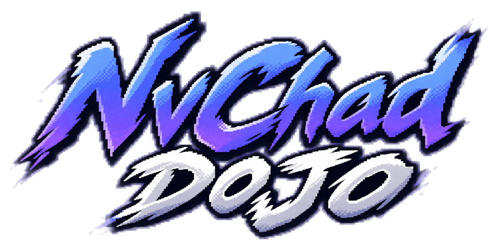
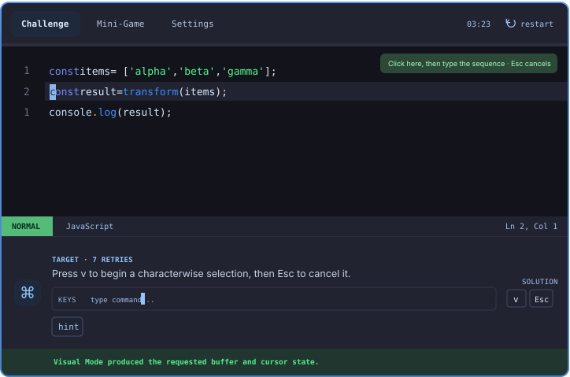

<div align="center">




**Learn Vim by doing, not just reading.**

A hands-on Vim training ground with interactive lessons, real code challenges, and repetition that builds muscle memory. Inspired by **NvChad**, but also useful for **Neovim and Vim**.

[**🥋 Start Training**](https://edmndx.github.io/NvChadDojo/) · [Source Code](https://github.com/edmndx/NvChadDojo) · [Report a Bug](https://github.com/edmndx/NvChadDojo/issues)

</div>

## What you can do

- **Challenge Mode** — practice motions, operators, and text objects in a simulated code editor with immediate feedback and hints.
- **Mini-Game** — build command recall through repeatable key-sequence drills.
- **Guided lessons** — learn navigation, editing, search, macros, registers, and NvChad-specific workflows.
- **Command reference** — quickly find Vim commands and shortcuts.
- **Trainer settings** — customize line numbers, arrow-key behavior, solutions, feedback, and supported key remaps.

## In action



> Click the trainer and type commands with your keyboard. The editor is a **learning simulation**, not a full Neovim installation.

## Run locally

```bash
git clone https://github.com/edmndx/NvChadDojo.git
cd NvChadDojo
npm ci
npm run dev
```

Built with React, TypeScript, and Vite.

---

<sub>**Fully vibe-coded.** An independent learning project made for Vim practice and muscle memory. Not affiliated with or endorsed by [NvChad](https://nvchad.com/) or [Neovim](https://neovim.io/).</sub>
