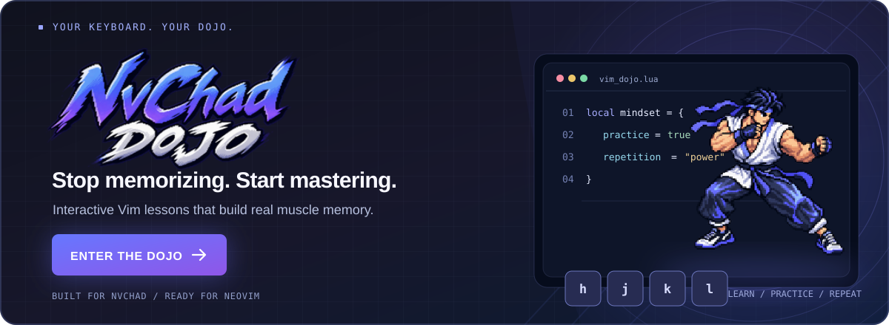

<div align="center">

[](https://edmndx.github.io/NvChadDojo/)

<br />

**A browser-based Vim training ground. Learn the motions. Build the muscle memory. Own your editor.**

[**🥋 Enter the Dojo**](https://edmndx.github.io/NvChadDojo/) · [Explore Lessons](https://edmndx.github.io/NvChadDojo/) · [Report an Issue](https://github.com/edmndx/NvChadDojo/issues)


</div>

---

## ⚡ Not another Vim cheatsheet.

You can memorize `ciw`, `dap`, or `ggVG`. But can you use them **without thinking**?

**NvChadDojo** is a free, interactive Vim tutorial focused on the part that actually matters: *practice*. Work through guided lessons, type real key sequences, solve editing challenges, and repeat until the commands become instinctive.

The course takes inspiration from the **[NvChad](https://nvchad.com/)** Neovim distribution, but the core Vim motions, operators, and text objects apply to **regular Neovim and Vim too**. NvChad-specific shortcuts are taught as a separate part of the curriculum.

> **Learn the command → use it in context → repeat until it sticks.**

## 🥋 What is inside the Dojo?

| | Training area | What you practice |
| :---: | --- | --- |
| 🎯 | **Interactive challenges** | Execute motions and editing commands in a simulated code editor, not just read about them. |
| 🕹️ | **Key sequence mini-game** | Build recall, speed, and consistency through repeatable drills. |
| 🧭 | **Vim foundations** | Modes, `hjkl`, words, lines, search, jumps, and navigation. |
| ✂️ | **Operators & text objects** | Combine `d`, `c`, `y` with motions and objects like `iw`, `i"`, and `ap`. |
| 🛠️ | **Real editing workflows** | Registers, macros, substitutions, visual editing, buffers, windows, and tabs. |
| 🚀 | **NvChad workflows** | Telescope, NvimTree, terminals, LSP actions, Git workflows, and common mappings. |
| 📖 | **Searchable command reference** | Look up commands and lessons when you need a refresher. |
| ⚙️ | **Configurable trainer** | Adjust line-number styles, arrow-key behavior, feedback, and supported custom key remaps. |

The editor is an **in-browser training simulation**, not a complete Neovim instance. Some lessons teach shortcut sequences rather than reproducing full plugin behavior.

## 🥊 The training loop

```text
      LEARN                      PRACTICE                     REPEAT
  ┌─────────────┐           ┌──────────────────┐         ┌─────────────┐
  │ Read a short│     →     │ Edit real-looking│    →    │ Build muscle│
  │ explanation │           │ code with keys   │         │ memory      │
  └─────────────┘           └──────────────────┘         └─────────────┘
```

Think in **verbs + targets**. Once `d` (delete), `c` (change), `y` (yank), and the motions click, Vim stops feeling like a list of random shortcuts and starts feeling like a language.

```vim
ciw     " change inside word
di"     " delete inside double quotes
dap     " delete around paragraph
ggVG    " select the whole buffer
:%s/old/new/g  " replace throughout the buffer
```

## 🧠 From beginner to keyboard ninja

The lessons cover:

**01. Foundations** — Vim modes, movement, insertion, essential motions.

**02. Editing fluency** — Operators, word/quote/bracket/paragraph text objects, visual editing, indentation, search and replace.

**03. Advanced moves** — Repeat commands, registers, macros, block editing, jump history, and multi-file workflows.

**04. The NvChad toolkit** — Telescope, NvimTree, terminals, buffer management, LSP, diagnostics, Git, completion, and configuration.

Jump straight to the [interactive curriculum](https://edmndx.github.io/NvChadDojo/). You do **not** need to install NvChad to start practicing.

## 🚀 Start training

### Play online — recommended

**[→ Launch NvChadDojo](https://edmndx.github.io/NvChadDojo/)**

Open the site in your browser, choose a lesson from the sidebar, click the trainer, and start typing. No installation required.

### Run locally

Requires Node.js and npm.

```bash
git clone https://github.com/edmndx/NvChadDojo.git
cd NvChadDojo
npm ci
npm run dev
```

Open the local address printed by Vite.

| Command | Purpose |
| --- | --- |
| `npm run dev` | Start the development server |
| `npm run build` | Type-check and build the production site |
| `npm run preview` | Preview the production build locally |
| `npm run check` | Run type checking, lint, formatting checks, build, and bundle-size check |

## 🧩 Tech stack

Built with **React**, **TypeScript**, **Vite**, and **Lucide**. Course content is organized into curriculum modules; the browser trainer implements interactive command practice. Trainer preferences are stored locally in your browser.

## 🤖 Built with vibes. Designed for practice.

**NvChadDojo is a fully vibe-coded personal project** created to make learning Neovim more hands-on, engaging, and accessible. The goal isn't to claim that AI-generated code is inherently better — it's to turn a simple idea into a useful learning environment:

*If Vim is a skill, you should be able to train it.*

Feedback, bug reports, and improvements are welcome. Because the project is AI-assisted, validate behavior against actual Vim/Neovim when contributing fixes.

## 🤝 Contributing

Found a missing motion, incorrect mapping, or a confusing lesson? [Open an issue](https://github.com/edmndx/NvChadDojo/issues). Pull requests are welcome.

For local changes, run `npm run check` before submitting.

## 📌 Acknowledgements & disclaimer

This is an **independent, community learning project** — **not** an official NvChad or Neovim project, and not affiliated with or endorsed by their maintainers.

Inspired by [NvChad](https://nvchad.com/), [Neovim](https://neovim.io/), and Vim's composable editing language.

---

<div align="center">

### Your mouse had a good run.

**Now let your keyboard take over.**

[**🥋 ENTER THE DOJO**](https://edmndx.github.io/NvChadDojo/) · [⭐ Star the repository](https://github.com/edmndx/NvChadDojo)

<sub>Made with ⌨️, curiosity, and a healthy amount of vibe coding.</sub>

</div>
